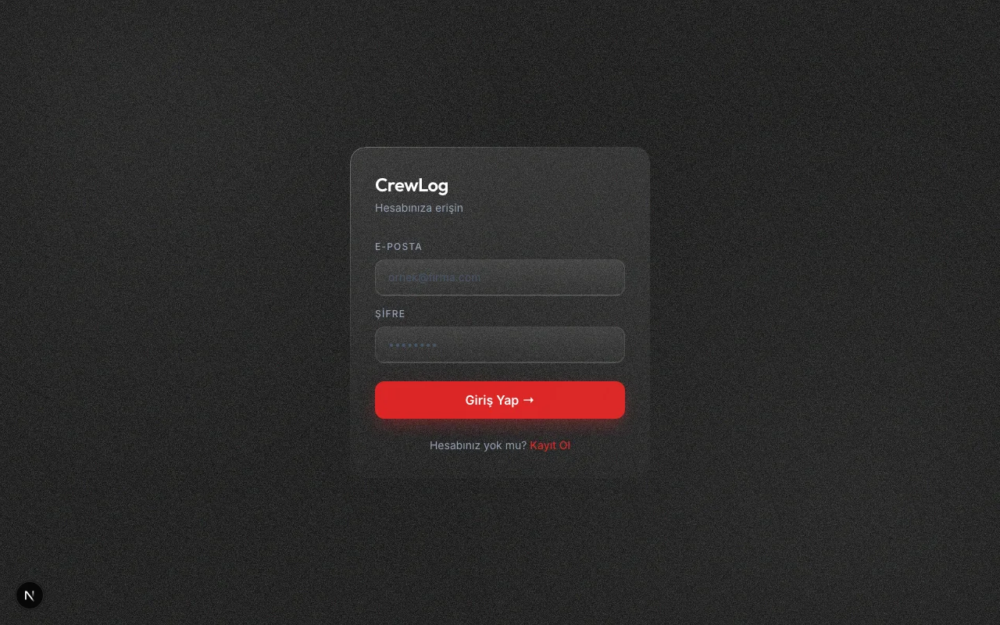
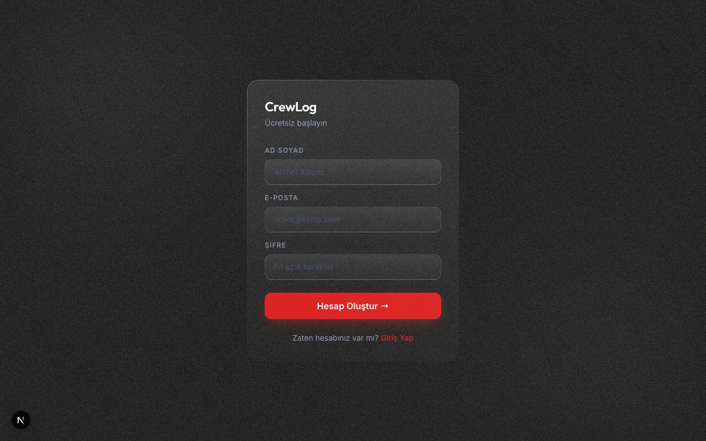

# CrewLog

İnşaat ve şantiye işletmeleri için **işçi takibi, puantaj ve bordro yönetim sistemi**. Müteahhitler (şirketler) kendi şantiyelerini, işçilerini, günlük puantajlarını, avans ve harcamalarını tek bir panelden yönetir; saha ekibi ise mobil uygulama ile QR kod üzerinden puantaj girişi yapar.

Proje iki parçadan oluşur:

| Klasör | Açıklama | Teknoloji |
| --- | --- | --- |
| [`web/`](web) | Yönetim paneli (şirket sahibi / yönetici) | Next.js 16, React 19, Tailwind CSS 4 |
| [`mobile/`](mobile) | Saha uygulaması (formen / işçi) | Expo, React Native, Expo Router |
| `schema.sql`, `migration_*.sql` | Veritabanı şeması ve geçişler | PostgreSQL (Supabase) |

Kimlik doğrulama, veritabanı ve dosya depolama için [Supabase](https://supabase.com) kullanılır.

## Özellikler

- **Çok kiracılı yapı:** Her şirket yalnızca kendi verisini görür (Row Level Security politikaları).
- **Rol ve yetki sistemi:** `owner`, `admin`, `foreman`, `worker` rolleri ve kullanıcı bazlı ayrıntılı yetkiler.
- **Şantiye yönetimi:** Şantiye ekleme/düzenleme, günlük şantiye notları, fotoğraflar ve harcamalar.
- **İşçi yönetimi:** İşçi kartları, belgeler, SGK bilgileri, avans kayıtları, işçiye özel QR kod.
- **Puantaj:** Takvim görünümü, günlük giriş/çıkış, fazla mesai, onay akışı; mobilden QR ile giriş.
- **Bordro ve raporlar:** Dönemlik bordro hesabı, rapor ekranı, Excel (`xlsx`) çıktısı ve yazdırma.
- **Harcamalar:** Şantiye ve şirket harcamalarının takibi.
- **Davet sistemi:** Çalışanları davet kodu ile şirkete katma.
- **Bildirimler:** Panelde bildirim zili, mobilde push bildirimleri.

## Ekran görüntüleri

Panelin iç sayfaları oturum ve Supabase verisi gerektirdiği için burada herkese açık giriş ekranları gösterilmektedir.

| Giriş | Kayıt |
| --- | --- |
|  |  |

## Gereksinimler

- Node.js 20 veya üzeri ve npm
- Bir Supabase projesi (ücretsiz katman yeterlidir)
- Mobil için: Expo Go uygulaması veya iOS/Android simülatörü

## Kurulum

### 1. Veritabanı

Supabase projenizin **SQL Editor** bölümünde dosyaları şu sırayla çalıştırın:

1. `schema.sql`
2. `migration_role_fix.sql`
3. `migration_user_permissions.sql`
4. `migration_rls.sql`

### 2. Web paneli

```bash
cd web
npm install
```

`web/.env.local` dosyasını oluşturun (değerleri kendi Supabase projenizden alın, bu dosyayı **asla** git'e eklemeyin):

```env
NEXT_PUBLIC_SUPABASE_URL=
NEXT_PUBLIC_SUPABASE_ANON_KEY=
SUPABASE_SERVICE_ROLE_KEY=
```

```bash
npm run dev
```

Panel <http://localhost:3000> adresinde açılır. İlk kullanıcı `/kayit` sayfasından hesap oluşturur, ardından `/sirket-kur` ile şirketini kurar.

Üretim derlemesi için: `npm run build && npm start`

### 3. Mobil uygulama

```bash
cd mobile
npm install
```

`mobile/.env` dosyasını oluşturun:

```env
EXPO_PUBLIC_SUPABASE_URL=
EXPO_PUBLIC_SUPABASE_ANON_KEY=
```

```bash
npm start        # Expo geliştirme sunucusu
npm run ios      # iOS simülatörü
npm run android  # Android emülatörü
```

## Ortam değişkenleri

| Değişken | Nerede | Açıklama |
| --- | --- | --- |
| `NEXT_PUBLIC_SUPABASE_URL` | web | Supabase proje adresi |
| `NEXT_PUBLIC_SUPABASE_ANON_KEY` | web | Herkese açık (anon) API anahtarı |
| `SUPABASE_SERVICE_ROLE_KEY` | web | Yalnızca sunucu tarafında kullanılan yönetici anahtarı. **Gizli tutun**, istemciye sızdırmayın. |
| `EXPO_PUBLIC_SUPABASE_URL` | mobile | Supabase proje adresi |
| `EXPO_PUBLIC_SUPABASE_ANON_KEY` | mobile | Herkese açık (anon) API anahtarı |

## Proje yapısı

```
crewlog/
├── schema.sql                     # Tablolar, RLS, yeni kullanıcı tetikleyicisi
├── migration_*.sql                # Sonradan eklenen geçişler
├── web/
│   ├── app/(auth)/                # giriş, kayıt, şirket kurma
│   ├── app/(dashboard)/           # panel sayfaları (işçiler, şantiyeler, puantaj, bordro…)
│   ├── app/actions/               # Server Actions (Supabase işlemleri)
│   └── lib/                       # Supabase istemcileri, yetki tipleri
└── mobile/
    ├── app/                       # Expo Router rotaları
    ├── screens/                   # Giriş, QR, puantaj, avans, harcama… ekranları
    └── lib/                       # Supabase ve bildirim yardımcıları
```
